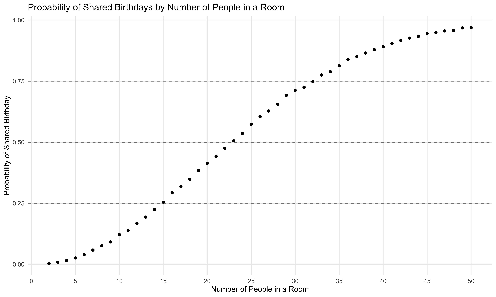

Data Science I (P8105), Homework 5
================
Max Hyman (mjh2289),
2026-11-12

##### Load packages

``` r
library(tidyverse)
```

##### Set global plotting options

``` r
knitr::opts_chunk$set(  
  collapse = TRUE,   
  fig.width = 10,
  fig.asp = 0.6,       
  out.width = "90%",   
  fig.retina = 2,     
  dpi = 300
  ) 
```

##### Set seed

``` r
set.seed(7)
```

# Problem 1

##### Suppose you put 𝑛 people in a room, and want to know the probability that at least two people share a birthday. For simplicity, we’ll assume there are no leap years (i.e. there are only 365 days) and that birthdays are uniformly distributed over the year (which is actually not the case). Write a function that, for a fixed group size, randomly draws “birthdays” for each person; checks whether there are duplicate birthdays in the group; and returns TRUE or FALSE based on the result.

``` r
source("Source/birthday.R")

birthday(5)
## [1] FALSE
birthday(10)
## [1] FALSE
birthday(25)
## [1] TRUE
```

The function was written as requested. Three tests cases were performed
to demonstrate TRUE and FALSE output

##### Next, run this function 10000 times for each group size between 2 and 50. For each group size, compute the probability that at least two people in the group will share a birthday by averaging across the 10000 simulation runs. Make a plot showing the probability as a function of group size, and comment on your results.

``` r
birthday_simulation <- 
  expand_grid(
    n_room = 2:50,
    iteration = 1:10000
    ) |> 
  mutate(birthday_shared = map_lgl(n_room, birthday))

birthday_simulation |> 
  group_by(n_room) |> 
  summarize(p_birthday_shared = mean(birthday_shared)) |> 
  ggplot() + 
  geom_point(mapping = aes(x = n_room, y = p_birthday_shared)) +
  geom_hline(yintercept = c(0.25, 0.50, 0.75), linetype = "dashed", alpha = 0.5) + 
  labs(
    title = "Probability of Shared Birthdays by Number of People in a Room",
    x = "Number of People in a Room",
    y = "Probability of Shared Birthday"
    ) + 
  theme_minimal() + 
  theme(
    panel.grid.minor.x = element_blank(),
    panel.grid.minor.y = element_blank()
    ) + 
  scale_x_continuous(breaks = seq(0, 50, by = 5))
```



This exhibit illustrates simulated results for the probability that at
least two people in the same room share a birthday based on how many
people are in a room. The probability was simulated across 10,000 rooms
of 2 people, 3 people, …, and 50 people. The probability eclipsed 0.25,
0.50, and 0.75 at 15, 23, and 32 people in a room, respectively.

# Problem 2

##### The zip file contains data from a longitudinal study that included a control arm and an experimental arm. Data for each participant is included in a separate file, and file names include the subject ID and arm.Create a tidy dataframe containing data from all participants, including the subject ID, arm, and observations over time: (1) Start with a dataframe containing all file names; the list.files function will help, (2) iterate over file names and read in data for each subject using purrr::map and saving the result as a new variable in the dataframe, and (3) tidy the result; manipulate file names to include control arm and subject ID, make sure weekly observations are “tidy”, and do any other tidying that’s necessary

##### Make a spaghetti plot showing observations on each subject over time, and comment on differences between groups.

# Problem 3

##### When designing an experiment or analysis, a common question is whether it is likely that a true effect will be detected – put differently, whether a false null hypothesis will be rejected. The probability that a false null hypothesis is rejected is referred to as power, and it depends on several factors, including: the sample size; the effect size; and the error variance. In this problem, you will conduct a simulation to explore power in a one-sample t-test. First set the following design elements: n = 30, sigma = 5.

``` r
n <- 30
sigma <- 5
```

##### Set mu = 0. Generate 5000 datasets from the model x ~ Normal\[mu, sigma\]

``` r
mu = 0
source("Source/normal_draw.R")

normal_simulation <- 
  tibble(mu_parameter = rep(mu, 5000)) |> 
  mutate(normal_draw_value = map(mu_parameter, normal_draw))
```

##### For each dataset, save mu_hat the p-value arising from a test of 𝐻: mu = 0 using alpha = 0.05. Hint: to obtain the estimate and p-value, use broom::tidy to clean the output of t.test.

t.test(x, y = mu, alternative = c(“two.sided”))
