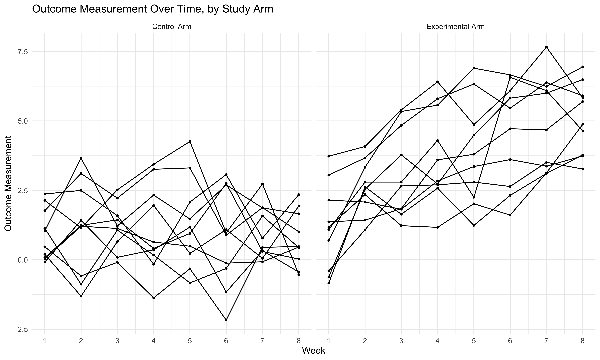
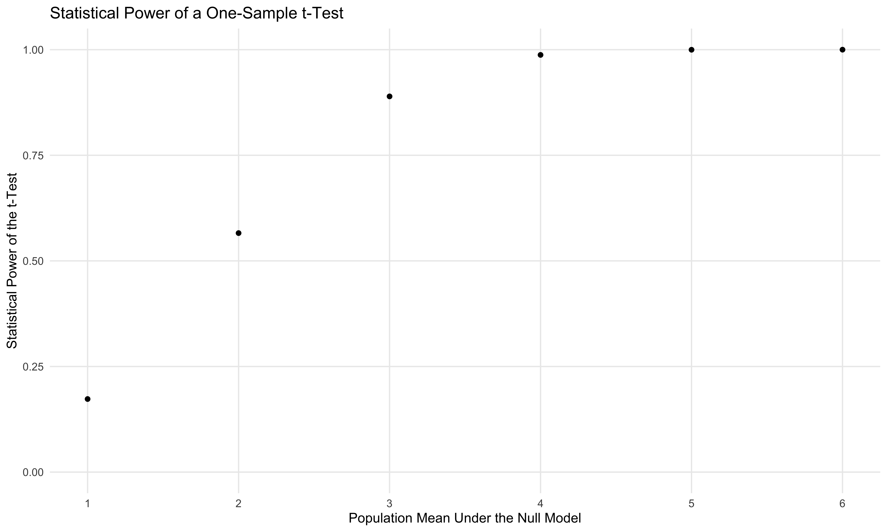
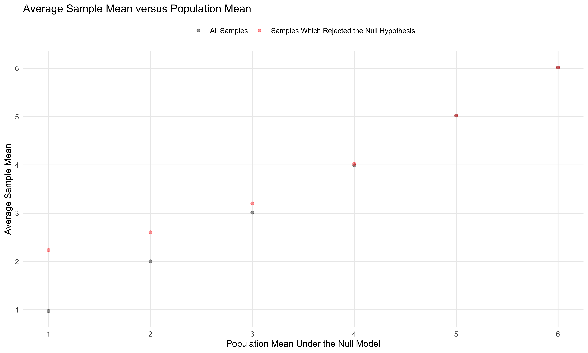

Data Science I (P8105), Homework 5
================
Max Hyman (mjh2289),
2026-11-13

##### Load packages

``` r
library(tidyverse)
```

##### Set global plotting options

``` r
knitr::opts_chunk$set(  
  collapse = TRUE,   
  fig.width = 10,
  fig.asp = 0.6,       
  out.width = "90%",   
  fig.retina = 2,     
  dpi = 300
  ) 
```

##### Set seed

``` r
set.seed(7)
```

# Problem 1

##### Suppose you put 𝑛 people in a room, and want to know the probability that at least two people share a birthday. For simplicity, we’ll assume there are no leap years (i.e. there are only 365 days) and that birthdays are uniformly distributed over the year (which is actually not the case). Write a function that, for a fixed group size, randomly draws “birthdays” for each person; checks whether there are duplicate birthdays in the group; and returns TRUE or FALSE based on the result.

``` r
source("Source/birthday.R")

birthday(5)
## [1] FALSE
birthday(10)
## [1] FALSE
birthday(25)
## [1] TRUE
```

The function was written as requested. I then performed three tests
cases to demonstrate TRUE and FALSE output.

##### Next, run this function 10000 times for each group size between 2 and 50. For each group size, compute the probability that at least two people in the group will share a birthday by averaging across the 10000 simulation runs. Make a plot showing the probability as a function of group size, and comment on your results.

``` r
birthday_simulation_df <- 
  expand_grid(
    n_room = 2:50,
    iteration = 1:10000
    ) |> 
  mutate(birthday_shared = map_lgl(n_room, birthday))

birthday_simulation_df |> 
  group_by(n_room) |> 
  summarize(p_birthday_shared = mean(birthday_shared)) |> 
  ggplot() + 
  geom_point(mapping = aes(x = n_room, y = p_birthday_shared)) +
  geom_hline(yintercept = c(0.25, 0.50, 0.75), linetype = "dashed", alpha = 0.5) + 
  labs(
    title = "Probability of Shared Birthdays by Number of People in a Room",
    x = "Number of People in a Room",
    y = "Probability of Shared Birthday"
    ) + 
  theme_minimal() + 
  theme(
    panel.grid.minor.x = element_blank(),
    panel.grid.minor.y = element_blank()
    ) + 
  scale_x_continuous(breaks = seq(0, 50, by = 5))
```


This exhibit illustrates simulated results for the probability that at
least two people in the same room share a birthday based on how many
people are in a room. The probability was simulated across 10,000 rooms
of 2 people, 3 people, …, and 50 people. The probability eclipsed 0.25,
0.50, and 0.75 at 15, 23, and 32 people in a room, respectively.

# Problem 2

##### The zip file contains data from a longitudinal study that included a control arm and an experimental arm. Data for each participant is included in a separate file, and file names include the subject ID and arm. Create a tidy dataframe containing data from all participants, including the subject ID, arm, and observations over time: (1) Start with a dataframe containing all file names; the list.files function will help, (2) iterate over file names and read in data for each subject using purrr::map and saving the result as a new variable in the dataframe, and (3) tidy the result; manipulate file names to include control arm and subject ID, make sure weekly observations are “tidy”, and do any other tidying that’s necessary

``` r
import_df <-  
  tibble(file_names_with_path = list.files("Data", full.names = TRUE)) %>% 
  mutate(
    participant_data = map(file_names_with_path, read_csv),
    participant_group = str_sub(file_names_with_path, 6, 8),
    participant_group = replace_when(participant_group, participant_group == "con" ~ "Control Arm"), 
    participant_group = replace_when(participant_group, participant_group == "exp" ~ "Experimental Arm"),
    participant_identifier = str_sub(file_names_with_path, 10, 11)
    ) %>% 
  select(-file_names_with_path) |> 
  relocate(participant_group, participant_identifier) |> 
  unnest(cols = c(participant_data)) |> 
  pivot_longer(
    cols = week_1:week_8,
    names_to = "week",
    values_to = "outcome_measurement",
    names_prefix = "week_"
    ) |> 
  mutate(
    participant_group = factor(participant_group),
    participant_identifier = factor(participant_identifier),
    week = as.numeric(week)
    )
```

I imported and tidied the data as requested. Key steps included (1)
using a map function to iteratively import each file, (2) parsing each
file name to identify each participant’s study arm and identifier, and
(3) transforming the data from long to wide format. The tidied dataset
includes 20 participants split 1:1 between control and experimental
arms. Each participant has 8 weekly outcome measurements.

##### Make a spaghetti plot showing observations on each subject over time, and comment on differences between groups.

``` r
import_df %>% 
  ggplot() + 
  geom_point(mapping = aes(x = week, y = outcome_measurement), size = 0.75) + 
  geom_line(mapping = aes(x = week, y = outcome_measurement, group = participant_identifier)) + 
  facet_wrap(~participant_group) + 
  theme_minimal() + 
  labs(
    title = "Outcome Measurement Over Time, by Study Arm",
    x = "Week",
    y = "Outcome Measurement"
    ) + 
  scale_x_continuous(breaks = seq(1, 8, by = 1))
```



This exhibit illustrates the outcome measurement over time for each
subject, by study arm. I observed that the control arm remains stable
over time, whereas the experimental arm increases over time.
Furthermore, there is variability in both arms as early as the first
week, with participants beginning with higher values of the outcome
tending to end with higher values of the outcome as well, and vice
versa.

# Problem 3

##### When designing an experiment or analysis, a common question is whether it is likely that a true effect will be detected – put differently, whether a false null hypothesis will be rejected. The probability that a false null hypothesis is rejected is referred to as power, and it depends on several factors, including: the sample size; the effect size; and the error variance. In this problem, you will conduct a simulation to explore power in a one-sample t-test. First set the following design elements: n = 30, $\sigma$ = 5.

``` r
n <- 30
sigma <- 5
```

##### Set $\mu$ = 0. Generate 5000 datasets from the model x ~ Normal\[$\mu$, $\sigma$\]. For each dataset, save $\hat{\mu}$ and the p-value arising from a test of H: $\mu_0$ = 0 using $\alpha$ = 0.05. Hint: to obtain the estimate and p-value, use broom::tidy to clean the output of t.test.

``` r
mu = 0
source("Source/normal_draw_t_test.R")

normal_simulation_mu_0_df <- 
  tibble(mu = rep(mu, 5000)) |> 
  mutate(output = map(mu, normal_draw_t_test)) |> 
  select(-mu) |> 
  unnest(cols = c(output))

normal_simulation_mu_0_df
## # A tibble: 5,000 × 2
##     mu_hat p_value
##      <dbl>   <dbl>
##  1 -1.51    0.166 
##  2 -0.824   0.480 
##  3  0.315   0.695 
##  4  1.59    0.0488
##  5  0.354   0.675 
##  6 -0.488   0.599 
##  7 -1.48    0.236 
##  8 -1.07    0.235 
##  9  0.692   0.481 
## 10 -0.0172  0.984 
## # ℹ 4,990 more rows
```

The function was written as requested. I then printed $\hat{\mu}$ and
the p-value for the first ten datasets.

##### Repeat the above for $\mu$ = {1,2,3,4,5,6}

``` r
normal_simulation_mu_1_to_6_df <- 
  expand_grid(
    mu = 1:6, 
    iteration = 1:5000
    ) |> 
  mutate(output = map(mu, normal_draw_t_test)) |> 
  unnest(cols = c(output))

normal_simulation_mu_1_to_6_df |> 
  filter(iteration == 1 | iteration == 5000)
## # A tibble: 12 × 4
##       mu iteration  mu_hat     p_value
##    <int>     <int>   <dbl>       <dbl>
##  1     1         1 -0.0124 0.988      
##  2     1      5000  0.500  0.611      
##  3     2         1  3.24   0.0000893  
##  4     2      5000  2.49   0.00919    
##  5     3         1  3.70   0.0000990  
##  6     3      5000  2.56   0.0137     
##  7     4         1  3.24   0.000851   
##  8     4      5000  4.10   0.000000228
##  9     5         1  3.45   0.000274   
## 10     5      5000  5.60   0.00000407 
## 11     6         1  4.93   0.0000109  
## 12     6      5000  5.65   0.0000114
```

The function was expanded as requested. I then printed $\hat{\mu}$ and
the p-value for the first and last dataset for each value of
$\hat{\mu}$.

##### Make a plot showing the proportion of times the null was rejected (the power of the test) on the y axis and the true value of 𝜇 on the x axis. Describe the association between effect size and power.

``` r
normal_simulation_mu_1_to_6_df |> 
  mutate(rejection = p_value < 0.05) |> 
  group_by(mu) |> 
  summarize(rejection_proportion = mean(rejection)) |> 
  ggplot() + 
  geom_point(mapping = aes(x = mu, y = rejection_proportion)) + 
  labs(
    title = "Statistical Power of a One-Sample t-Test",
    x = "Population Mean Under the Null Model",
    y = "Statistical Power of the t-Test"
    ) + 
  theme_minimal() + 
  theme(
    panel.grid.minor.x = element_blank(),
    panel.grid.minor.y = element_blank()
    ) + 
  scale_x_continuous(breaks = seq(1, 6, by = 1)) + 
  scale_y_continuous(
    limits = c(0,1),
    breaks = seq(0, 1, by = 0.25)
    )
```



This exhibit illustrates the statistical power of a one-sample t-test
for $\mu$ = {1,2,3,4,5,6} under the null model. Each result represents
the proportion of times the null model was rejected across 5000
simulated datasets of 30 observations drawn from the normal distribution
with the specified population mean and sigma = 5. Statistical power
increases as $\mu$ deviates farther from 0, approaching 1.00 when $\mu$
reaches 4. I conclude that statistical power is positively associated
with effect size.

##### Make a plot showing the average estimate of 𝜇̂ on the y axis and the true value of 𝜇 on the x axis. Make a second plot (or overlay on the first) the average estimate of 𝜇̂ only in samples for which the null was rejected on the y axis and the true value of 𝜇 on the x axis. Is the sample average of 𝜇̂ across tests for which the null is rejected approximately equal to the true value of 𝜇? Why or why not?

``` r
normal_simulation_mu_1_to_6_df |> 
  group_by(mu) |> 
  summarize(mu_hat_average = mean(mu_hat))
## # A tibble: 6 × 2
##      mu mu_hat_average
##   <int>          <dbl>
## 1     1          0.976
## 2     2          2.00 
## 3     3          3.01 
## 4     4          3.99 
## 5     5          5.02 
## 6     6          6.02
normal_simulation_mu_1_to_6_df |> 
  filter(p_value < 0.05) |> 
  group_by(mu) |> 
  summarize(mu_hat_average = mean(mu_hat)) 
## # A tibble: 6 × 2
##      mu mu_hat_average
##   <int>          <dbl>
## 1     1           2.24
## 2     2           2.61
## 3     3           3.20
## 4     4           4.02
## 5     5           5.02
## 6     6           6.02

normal_simulation_mu_1_to_6_df_r <- normal_simulation_mu_1_to_6_df |> 
  filter(p_value < 0.05) |> 
  mutate(rejected = "Samples Which Rejected the Null Hypothesis")

bind_rows(normal_simulation_mu_1_to_6_df, normal_simulation_mu_1_to_6_df_r) |> 
  mutate(rejected = factor(replace_na(rejected, "All Samples"))) |> 
  group_by(mu, rejected) |> 
  summarize(mu_hat_average = mean(mu_hat)) |> 
  ggplot() + 
  geom_point(mapping = aes(x = mu, y = mu_hat_average, color = rejected), alpha = 0.4) + 
  labs(
    title = "Average Sample Mean versus Population Mean",
    x = "Population Mean Under the Null Model",
    y = "Average Sample Mean"
    ) + 
  theme_minimal() + 
  theme(
    panel.grid.minor.x = element_blank(),
    panel.grid.minor.y = element_blank(),
    legend.position = "top",
    legend.title = element_blank(),
    ) + 
  scale_x_continuous(breaks = seq(1, 6, by = 1)) + 
  scale_y_continuous(
    limits = c(0.9,6.1),
    breaks = seq(1, 6, by = 1)
    ) + 
  scale_color_manual(values = c("black", "red"))
```



This exhibit illustrates the average $\hat{\mu}$ versus $\mu$ under the
null model for the average $\hat{\mu}$ calculated across (1) all
samples, and (2) samples which rejected the null hypothesis. Whereas
average $\hat{\mu}$ calculated across all samples is approximately equal
to $\mu$ at every value of $\mu$ due to normal sampling, average
$\hat{\mu}$ calculated across samples which rejected the null hypothesis
is greater than $\mu$ at $\mu$ = {1, 2, 3} and approximately equal $\mu$
at $\mu$ = {4, 5, 6}. This finding relates to the previous exhibit in
which statistical power is approximately equal to 1 for $\mu$ = {4, 5,
6} versus less than one at $\mu$ = {1, 2, 3}, and that when $\mu$ \> 0,
rejection is more common in samples in which $\hat{\mu}$ \> $\mu$ given
$\mu_0 = 0$ and $\mu > 0$.
